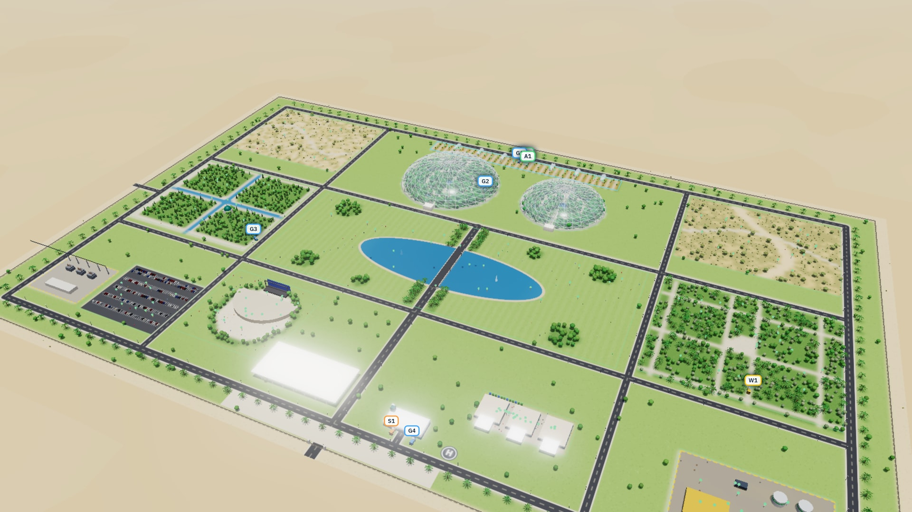
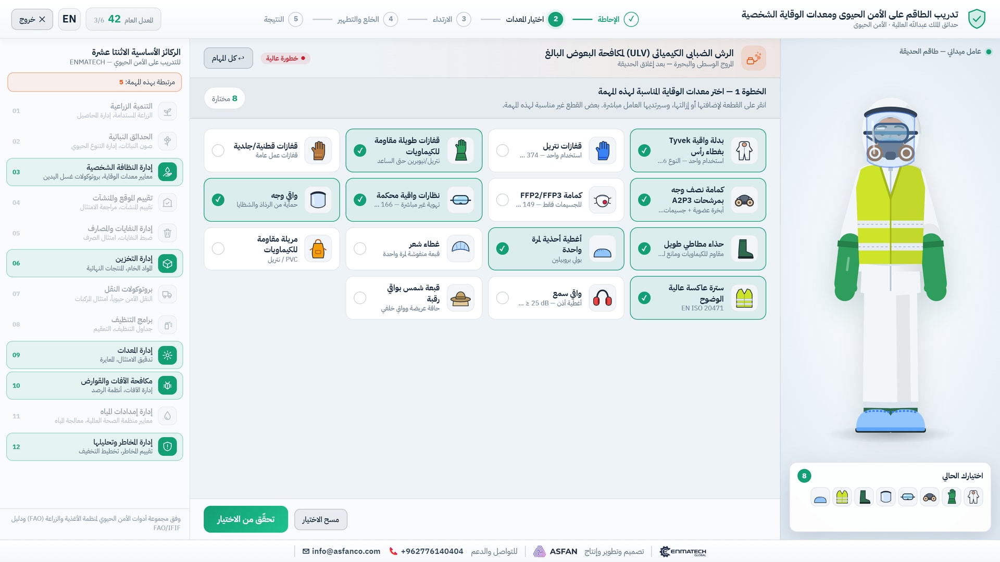
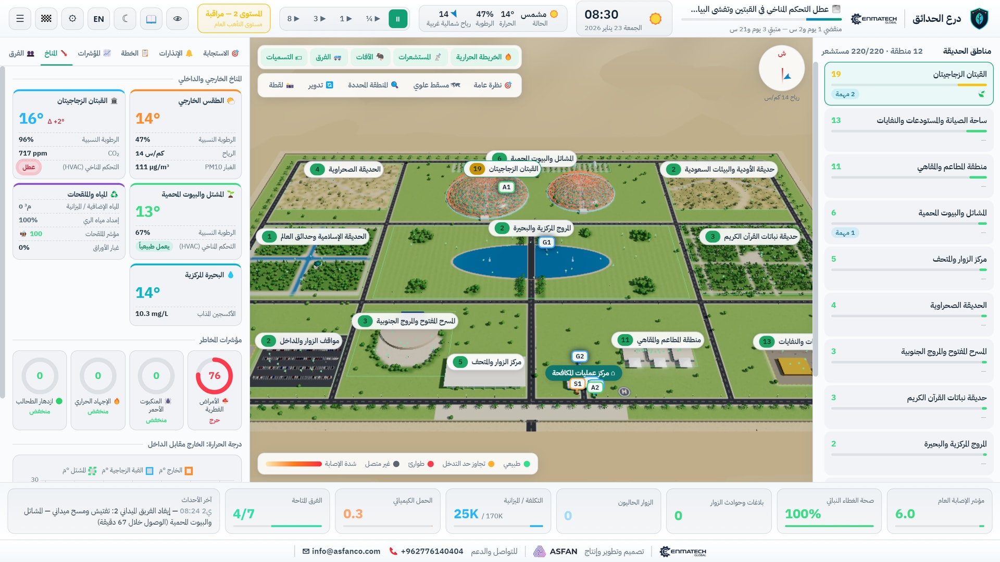

# درع الحدائق — التوأم الرقمي للأمن الحيوي والبيئة ومراقبة الخبراء

**GardenShield Twin — Biosecurity, Environmental Protection & Expert Monitoring Digital Twin**

**ENMATECH GLOBAL** · تصميم وتطوير وإنتاج **ASFAN**

منصة توأم رقمي ثلاثي الأبعاد لـ **حدائق الملك عبدالله العالمية** بالرياض. تعمل دون إنترنت باللغتين العربية والإنجليزية، والمظهر الفاتح هو الأساس مع مظهر داكن اختياري. تبدأ من صفحة رئيسية بثلاثة مسارات:

- 🛡️ **الأمن الحيوي:** تدريب الطاقم على الأمن الحيوي ومعدات الوقاية الشخصية (اختيار المعدات، الارتداء، الخلع وإزالة التلوث)، الشحنات المصابة، سوسة النخيل، البعوض، القوارض، النظافة في المطاعم.
- 🌿 **المحافظة على البيئة:** ازدهار الطحالب في البحيرة، النباتات الغازية، موجات الحر والري المستدام، حماية الملقّحات.
- 🔬 **مراقبة الخبراء:** الآفات والأمراض الزراعية، ومناخ القباب والمشاتل مقابل الطقس الخارجي، والجراد والعقارب والنمل الأبيض والأزمات المركّبة.

تعرض الصفحة الرئيسية أيضاً **برامج إضافية بحساب منفصل**: خبراتنا في كل من محمية الطيور ومحمية الفراشات (برنامجان مستقلان، بعرض مالي منفصل)، وقصص نجاحنا في الولايات المتحدة وباكستان وفيتنام.

يضم البرنامج 23 سيناريو و220 مستشعراً و68 إجراءً للمكافحة المتكاملة و21 آفة ومرضاً. كل سيناريو يُقيَّم من 100 وينتهي بتقرير PDF.

## ⬇️ التحميل

| الملف | الوصف |
|---|---|
| [**GardenShield-Twin-Setup-2.0.0.exe**](https://github.com/asfantrading-create/GardenShield-Twin-ENMATECH/releases/latest/download/GardenShield-Twin-Setup-2.0.0.exe) | المثبّت، ويُنشئ اختصاراً على سطح المكتب وفي قائمة ابدأ |
| [**GardenShield-Twin-Portable-2.0.0.exe**](https://github.com/asfantrading-create/GardenShield-Twin-ENMATECH/releases/latest/download/GardenShield-Twin-Portable-2.0.0.exe) | نسخة محمولة تعمل مباشرة دون تثبيت |
| [**GardenShield-Twin-User-Guide-AR-EN.pdf**](https://github.com/asfantrading-create/GardenShield-Twin-ENMATECH/releases/latest/download/GardenShield-Twin-User-Guide-AR-EN.pdf) | دليل المستخدم بالعربية والإنجليزية مع صور توضيحية |
| [**GardenShield-Twin-Video-AR-EN.mp4**](https://github.com/asfantrading-create/GardenShield-Twin-ENMATECH/releases/latest/download/GardenShield-Twin-Video-AR-EN.mp4) | فيديو تعريفي بالبرنامج وصفحاته (5 دقائق تقريباً) |

صفحة كل الإصدارات: [Releases](https://github.com/asfantrading-create/GardenShield-Twin-ENMATECH/releases)

## متطلبات التشغيل

- Windows 10 أو 11 (64-بت)
- ذاكرة 8 جيجابايت
- بطاقة رسوميات تدعم WebGL 2
- شاشة بدقة 1366×768 أو أعلى (يُفضّل 1920×1080)

**الترخيص:** فترة تجريبية مدتها 14 يوماً تبدأ من أول تشغيل. للتفعيل الكامل افتح «حول البرنامج والترخيص» من القائمة الرئيسية وأرسل معرّف الجهاز إلى المورّد.

**للتواصل:** ENMATECH GLOBAL — الرياض · www.enmksa.com · info@enmksa.com — ASFAN · ‎+962 77 614 0404 · info@asfanco.com

---

## English

A 3D digital twin of **King Abdullah International Gardens**, Riyadh. It works offline in Arabic and English, with a light theme by default and an optional dark theme. The start page offers three tracks:

- 🛡️ **Biosecurity:** staff biosecurity and PPE training (choosing PPE, donning, doffing and decontamination), infested consignments, red palm weevil, mosquitoes, rodents and food-court hygiene.
- 🌿 **Environmental protection:** harmful algal bloom in the lake, invasive plants, heat waves with sustainable irrigation, and pollinator protection.
- 🔬 **Expert monitoring:** pests and plant diseases, dome and nursery climate compared with outdoor weather, locusts, scorpions, termites and compound crises.

The start page also presents **additional programs, separately priced**: our expertise in both the Bird Sanctuary and the Butterfly Sanctuary (two standalone programs, priced in a separate offer), and our success stories in the United States, Pakistan and Vietnam.

It includes 23 scenarios, 220 sensors, 68 IPM actions and 21 pests and diseases. Every scenario is scored out of 100 and ends with a PDF report.

### Download

- [Installer — GardenShield-Twin-Setup-2.0.0.exe](https://github.com/asfantrading-create/GardenShield-Twin-ENMATECH/releases/latest/download/GardenShield-Twin-Setup-2.0.0.exe)
- [Portable — GardenShield-Twin-Portable-2.0.0.exe](https://github.com/asfantrading-create/GardenShield-Twin-ENMATECH/releases/latest/download/GardenShield-Twin-Portable-2.0.0.exe)
- [User guide (Arabic / English) — PDF](https://github.com/asfantrading-create/GardenShield-Twin-ENMATECH/releases/latest/download/GardenShield-Twin-User-Guide-AR-EN.pdf)
- [Explainer video — MP4](https://github.com/asfantrading-create/GardenShield-Twin-ENMATECH/releases/latest/download/GardenShield-Twin-Video-AR-EN.mp4)

**Requirements:** Windows 10/11 (64-bit), 8 GB RAM, a WebGL 2 graphics card, and a screen of 1366×768 or larger.

The software includes a 14-day trial. Activate it from "About & Licence" in the main menu.

**Contact:** ENMATECH GLOBAL, Riyadh · www.enmksa.com · info@enmksa.com — ASFAN · +962 77 614 0404 · info@asfanco.com

© 2026 ENMATECH GLOBAL — Designed, developed & produced by ASFAN.
